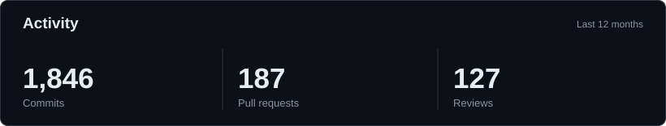
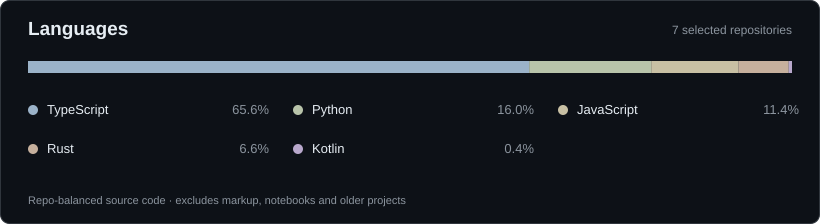

[affankhan.dev](https://affankhan.dev)

Computer Science and Mathematics at the University of Manchester. Previously interned at Amazon (Prime Video) and Electronic Arts.

*I use AI extensively for coding and code review. These figures reflect AI-assisted development activity, not code written entirely by hand.*

*Automatically calculated from [seven selected public repositories](./scripts/render_profile.py), weighted equally per repository. Older C# game projects, notebooks, CSS and HTML are excluded.*

### Projects

- [Atlas](https://github.com/affank1020/atlas) — Self-hosted AI agent platform with persistent context, development workspaces and controlled tools.
- [Relay](https://github.com/affank1020/relay) — Self-hosted chat and agent orchestration.
- [ASCII Donut](https://github.com/affank1020/ascii-donut) — 3D rotation, projection and lighting rendered in ASCII.
