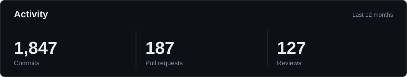
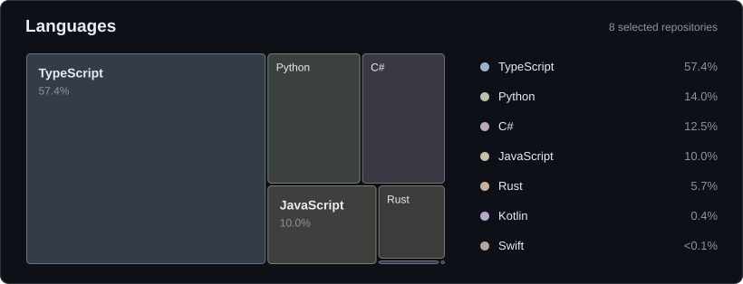

[affankhan.dev](https://affankhan.dev)

Computer Science and Mathematics at the University of Manchester. Previously interned at Amazon (Prime Video) and Electronic Arts.

*I use AI extensively for coding and code review. These figures reflect AI-assisted development activity, not code written entirely by hand.*

*Language mix across [eight selected public projects](./scripts/render_profile.py), weighted equally by repository.*
